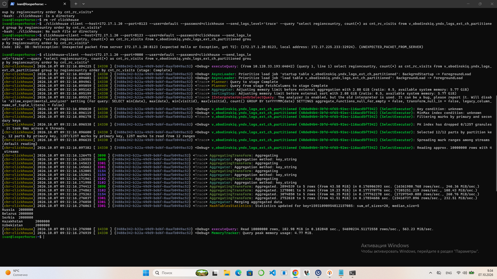
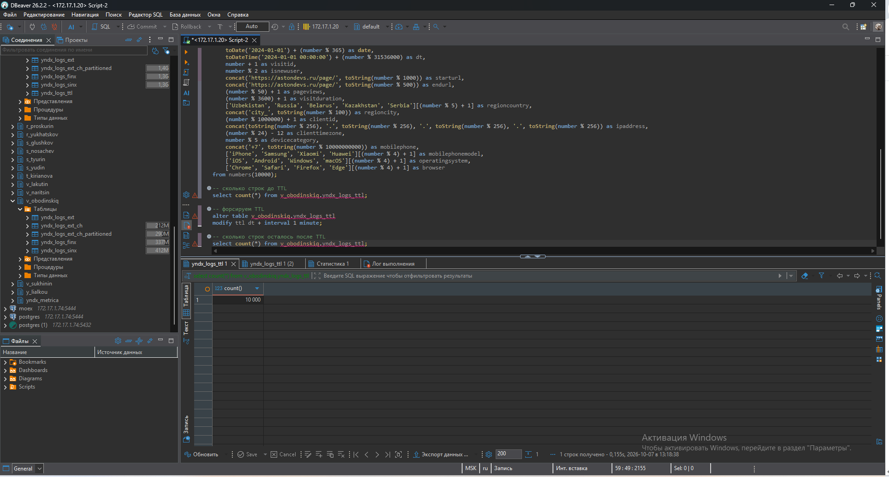
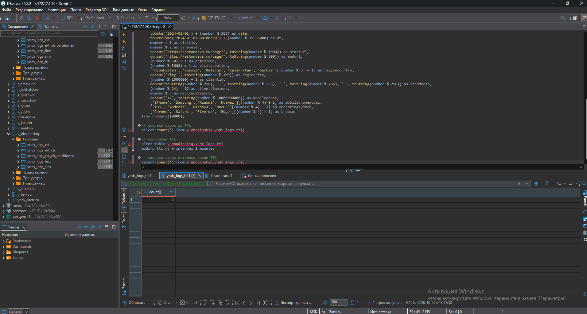

# ClickHouse

## 1. Создание внешней таблицы в ClickHouse для интеграции с Greenplum:
- Для начала настроил подключение с Greenplum и ClickHouse в DBeaver.
- Скрипт: [Скрипт создания внешней таблицы](sql/1_сreate_table_gp.sql). Создал схему v_obodinskiq, создал таблицу, выбрал randomly(рандомное распределение по сегментам кластера), так как это копия таблицы, с ней работать не будем, поэтому локальные join не нужны. Но лучше соблюсти равномерное распределение по сегментам кластера.
- Скрипт: [Скрипт создания внешней таблицы и именованной коллекции в CH](sql/2_сreate_external_table_ch.sql). Создал внешнюю таблицу и схему в ClickHouse, а также создал именованную коллекцию для секъюрности, где передаю параметры подключения к GP, включая логин и пароль.
- Выполнил простой запрос на подсчёт всех строк, длительность которого составила 27 секунд:
```select count(*) from v_obodinskiq.yndx_logs_ext```, подсчёт а не выгрузка всех строк была выбрана целенаправлена, так как в логах при выгрузке всех строк шло ограничение на 200 строк.

## 2. Создание таблицы в ClickHouse, генерация данных и проведение аналитических запросов:
- Скрипт: [Скрипт просмотра метаданных и создания таблицы в CH](sql/3_сreate_table_yndx_logs_ext_ch.sql). Создал таблицу yndx_logs_ext_ch, метаданные взял из уже созданной таблицы, в ClickHouse с использованием движка MergeTree;
- Скрипт: [Генерация данных для таблицы в CH](sql/4_data_generation_and_insert.sql). Сгенерировал 10 миллионов строк.
- Выполнил простой запрос на подсчёт всех строк, длительность которого составила 0.029 секунд против 27 секунд при подсчёте во внешней таблице ```select count(*) from v_obodinskiq.yndx_logs_ext_ch```
- Были выполнены 3 запроса на агрегацию, время выполнения в комментариях. Скрипт: [Скрипты 3-х запросов на агрегацию](sql/5_agg_query_logs_ext_ch.sql).
- Создал партиционированную таблицу v_obodinskiq.yndx_logs_ext_ch_partitioned, и повторил запросы. Скрипт: [Создание партиционированной таблицы и перенос данных для таблицы в CH](sql/6_create_partition_table_and_insert.sql), [Скрипты 3-х запросов на агрегацию](sql7_agg_query_logs_ex_ch_partitoned.sql).
- По итогам операций в партиционированной таблице производительность ухудшилась, поэтому решил проверить как работает запрос через explain.
- В результате анализа explain было обнаружено 60 физических частей в 12 партициях. Фильтр на 6 месяцев попадал в 30 частей вместо 6. Всреднем по 5 частей на каждый месяц.  
Из-за этого фильтр на 6 месяцев захватывал 30 частей вместо ожидаемых 6, что увеличивало расходы на открытие и чтение данных.  
Вероятнее всего причиной стало выполнение вставки параллельно, несколькими потоками, а фоновые merges не успели объединять данные, что привело к появлению 5 физических частей вместо одной. Скрипт: [Анализ производительности партиционированной таблицы](sql/8_explain_logs_ex_ch_partitioned.sql).
- Для исправления была выполнена команда ```optimize table v_obodinskiq.yndx_logs_ext_ch_partitioned final;```, она форсировала merge всех частей внутри каждой партиции в одну.
- После оптимизации выполнил запрос повторно. Скрипт: [Анализ производительности партиционированной таблицы](sql/8_explain_logs_ex_ch_partitioned.sql).
- В итоге производительность исправилась, количество частей сократилось до 12 (по одной на партицию), агрегационые запросы ускорились, [Скрипты 3-х запросов на агрегацию из исправленной таблицы, время выполнения в комментариях](sql/9_agg_query_logs_ex_ch_fixed.sql):  
Запрос 1. Запрос на агрегацию - простой count с группировкой, длительность - 0.066 секунд, вместо 0.11 секунд.  
Запрос 2. Агрегация с фильтрацией по дате, длительность - 0.053 секунд, вместо - 0.095 секунд.  
Запрос 3. Агрегация по высококардинальному столбцу, длительность - 0.44 секунд, вместо - 0.58 секунд.  
После оптимизации видим существенный прирост в производительности запросов.
- В рамках освоения методов профилирования запросов выполнил установку clickhouse-client на WSL. Выполнил подключеник к ClickHouse CERBER, и выполнил запрос с логами для получения статистик. 


## 3. Работа с первичными индексами в ClickHouse:
- Создал таблицу yndx_logs_finx с первичными индексами в ClickHouse, и сгенерировал данные для неё. [Создание таблицы c первичными индексами и перенос данных для таблицы в CH](sql/6_create_partition_table_and_insert.sql)
- Оптимизируем таблицу после вставки 10 миллионов строк, так как снова было 5 частей, хотя должна была быть одна ```optimize table v_obodinskiq.yndx_logs_finx final```;
- Проверил работу первичного индекса при помощи 2 запросов, результаты в комментарии скриптов. Скрипт: [Проверка работы первичного индекса](sql/11_explain_logs_finx.sql).


## 4. Работа с вторичными индексами в ClickHouse:
- Создать таблицу yndx_logs_sinx, и заранее выполнил оптимизацию. Скрипт: [Создание таблицы yndx_logs_sinx CH](sql/12_create_yndx_logs_sinx_and_insert.sql)
- Выполнил explain до создания индекса. Скрипт: [Explain таблицы yndx_logs_sinx CH](sql/13_explain_yndx_logs_sinx.sql). По результатам explain:  
Parts: 1/1 - Таблица слита в одну часть после OPTIMIZE FINAL  
Granules: 1224/1224 - Читаются все гранулы - полное сканирование  
В выводе не было блока Skip - значит, вторичного индекса idx_rand_string нет.  
Первичный индекс не содержит rand_string - не может по нему отсекать.  
ClickHouse вынужден читать все гранулы, чтобы найти строки с rand_string = 'str_123456'.
- Добавил индекс, выбрал тип bloom_filter - подходит для задачи поиска точного значения в столбце с высокой кардинальностью. А также выполнил материализацию. Скрипт: [Добавление и материализация индекса yndx_logs_sinx CH](sql/14_add_index_yndx_logs_sinx.sql).
- Выполнил explain после создания индекса. Скрипт: [Explain таблицы yndx_logs_sinx CH](sql/13_explain_yndx_logs_sinx.sql). По результатам explain:  
Skip присутствует	- Индекс создан, материализован и применяется.
Granules: 84/1224	84 из 1224  
Отсечено более 90 % данных — читается ~700 тысяч строк вместо 10 миллионов  

| Состояние | Granules | Ranges | Отсечение |
|---|---|---|---|
| До индекса | 1224/1224 | 1 | 0 % |
| После bloom_filter GRANULARITY 4 | 84/1224 | 20 | > 90 % |

## 5. Управление временем хранения данных в ClickHouse:
- Создал таблицу yndx_logs_ttl с использованием опций TTL (Time to Live) для управления временем хранения данных. [Создание таблицы yndx_logs_ttl CH](sql/15_create_ttl_table_yndx_logs_ttl.sql)
- Проверил сколько строк до TTL ```select count(*) from v_obodinskiq.yndx_logs_ttl;```  

- Применил TTL после создания таблицы, так как при применении TTL при создании, строки удалялись сразу  ``` alter table v_obodinskiq.yndx_logs_ttl modify ttl dt + interval 1 minute; ```
- Проверил сколько строк осталось после TTL ```select count(*) from v_obodinskiq.yndx_logs_ttl;``` 

## 6. Оптимизация таблиц и анализ кусков (parts), начнём с анализа:
- Проверил с помощью explain, количество parts. Скрипт: [Explain таблиц](sql/15_create_ttl_table_yndx_logs_ttl.sql)
- По результатам анализа было выявлено, что все таблицы кроме v_obodinskiq.yndx_logs_ext_ch и v_obodinskiq.yndx_logs_ttl были ранее оптимизированы. 
- Исходя из того что v_obodinskiq.yndx_logs_ttl - ограничена по времени жизни, и на текущий момент данные из неё были очищены. Оптимизировать её не стал.
- Оптимизировал постоянную ранее неоптимизированную таблицу ```optimize table v_obodinskiq.yndx_logs_ext_ch final;```.
- После оптимизации проверил количество частей, с помощью ```explain indexes = 1 select count(*) from v_obodinskiq.yndx_logs_ext_ch where visitid = '100000';```  
Количество частей сократилось с 5 до 1, следовательно таблица была оптимизирована.

## 7. Использование алиасов для типов данных в ClickHouse:
- Выполнил запрос на получение всех алиасов для типа данных String в системе ClickHouse:
```
select
	name as alias,
	alias_to as base_type,
	case_insensitive
from system.data_type_families
where alias_to = 'String'
order by alias;
```
- Результат:

| Алиас | Базовый тип | Case-insensitive |
|---|---|---|
| BINARY LARGE OBJECT | String | 1 |
| BINARY VARYING | String | 1 |
| BLOB | String | 1 |
| BYTEA | String | 1 |
| CHAR | String | 1 |
| CHAR LARGE OBJECT | String | 1 |
| CHAR VARYING | String | 1 |
| CHARACTER | String | 1 |
| CHARACTER LARGE OBJECT | String | 1 |
| CHARACTER VARYING | String | 1 |
| CLOB | String | 1 |
| LONGBLOB | String | 1 |
| LONGTEXT | String | 1 |
| MEDIUMBLOB | String | 1 |
| MEDIUMTEXT | String | 1 |
| NATIONAL CHAR | String | 1 |
| NATIONAL CHAR VARYING | String | 1 |
| NATIONAL CHARACTER | String | 1 |
| NATIONAL CHARACTER LARGE OBJECT | String | 1 |
| NATIONAL CHARACTER VARYING | String | 1 |
| NCHAR | String | 1 |
| NCHAR LARGE OBJECT | String | 1 |
| NCHAR VARYING | String | 1 |
| NVARCHAR | String | 1 |
| TEXT | String | 1 |
| TINYBLOB | String | 1 |
| TINYTEXT | String | 1 |
| VARBINARY | String | 1 |
| VARCHAR | String | 1 |
| VARCHAR2 | String | 1 |